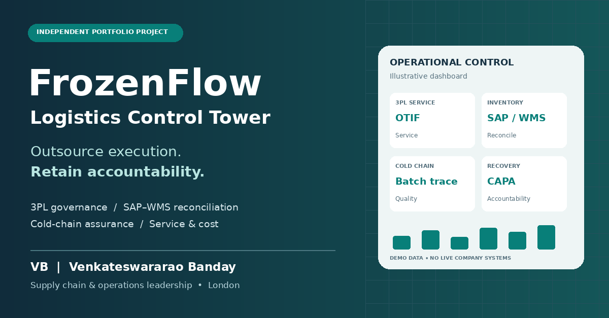

# FrozenFlow | Logistics Control Tower

An independent, interactive portfolio prototype by **VB (Venkateswararao Banday)**: a control tower for any operation that outsources warehousing and transport (frozen, chilled, ambient FMCG, retail). Not affiliated with any employer.

## Run it
Open `index.html` in a modern browser. No server, build step or API key.

## Modules
Overview · **Insights** (exception Pareto, site vs target, cost variance, FEFO ship-first list, auto weekly briefing, print to PDF) · Orders & POD · 3PL scorecard · Stock reconciliation · Cold chain · Actions & recovery · Cost & claims · **Planning tools** (risk-ranked cycle counts, tender scorecard, rate/volume variance, service-credit estimator) · **Data & settings** (profiles, editable targets and temperature threshold, CSV import, JSON backup/restore) · 90-day plan · Interview · About.

## Use your own data
Data & settings → choose a profile → paste CSV.
- Orders: `Order, Customer, Site, Carrier, Ordered, Delivered, On-time (1/0), Status, Batch` (Status: Verified / Exception / Missing / Wrong product)
- Stock: `SKU, Batch, Site, SAP qty, WMS qty, Status, Expiry (YYYY-MM-DD)`

## KPI definitions
Verified OTIF = on time, exact quantity, correct product and verified POD / all orders (stricter than most contracts; agree the real definition). Order accuracy = exact quantity and no wrong-product exception / all orders. Stock line accuracy = exact SAP/WMS matches by SKU-batch-site / all lines. Profile targets and temperature thresholds are illustrative; Quality owns product disposition.

## Limitations
Single-file HTML/CSS/JS, data kept in browser localStorage. No live SAP/WMS/TMS connection, authentication, shared data or audit trail. Sample data is fictional. Do not enter confidential data in a public demo.

## About the builder
VB (Venkateswararao Banday) is a supply chain and operations leader with UK right to work, based in London. Built with AI and shared free. Contact: venkat.banday@gmail.com · [LinkedIn](https://www.linkedin.com/in/venkateswararao-banday)
